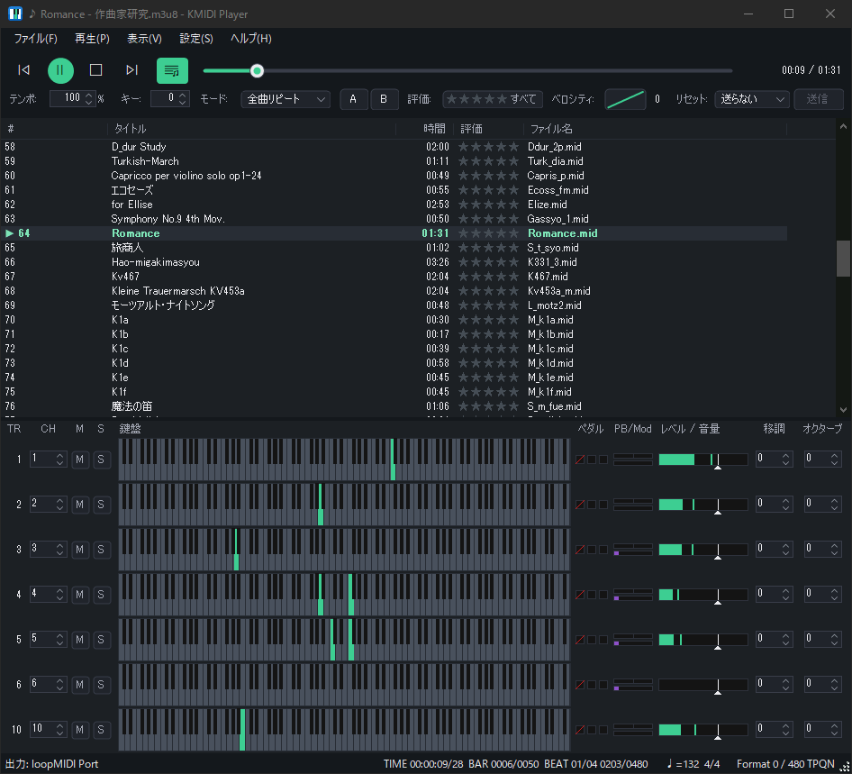
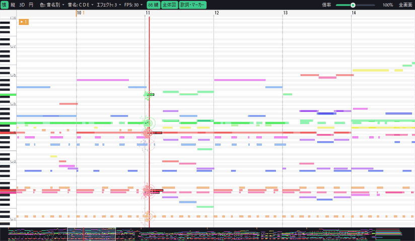
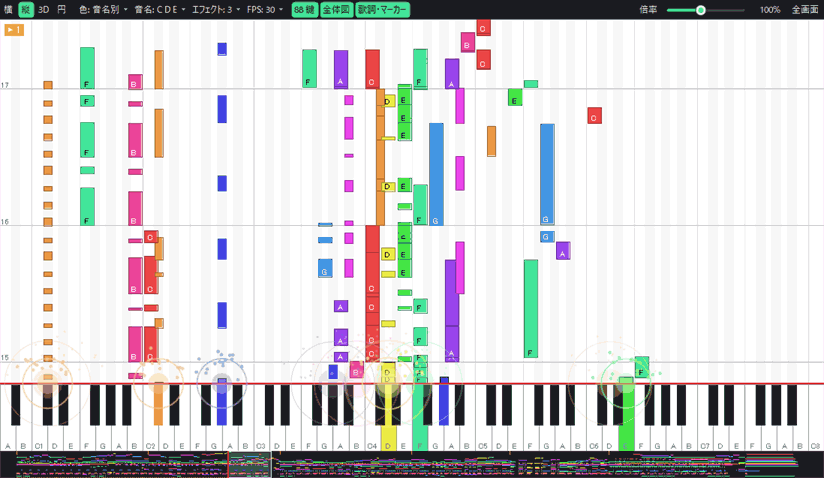
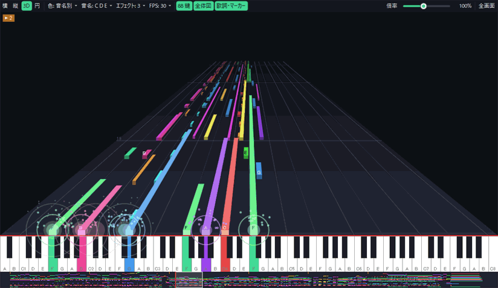
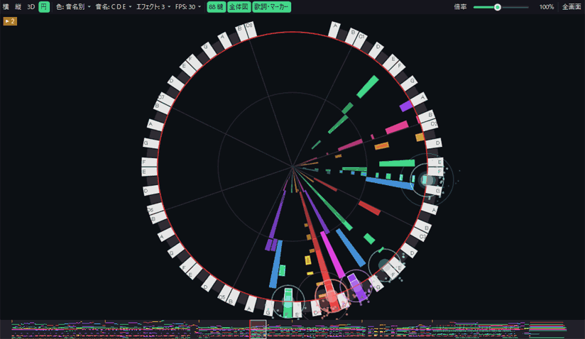

<p align="center">
  
</p>

<h1 align="center">KMIDI Player</h1>

<p align="center">
  <a href="README.md">English</a> | <b>日本語</b>
</p>

<p align="center">
  Windows 用の MIDI プレーヤー。インストール不要で、exe をダブルクリックするだけで使えます。
</p>

---

標準 MIDI ファイル（.mid）を、Windows の MIDI 出力デバイス（外部音源・ソフトウェア音源・Microsoft GS Wavetable Synth など）で再生します。
プレイリストを中心とした画面で、たくさんの曲を整理しながら聴けます。
16 チャンネル分の鍵盤やレベルメーター、ピアノロールで、演奏の中身を目で見て楽しめます。

<p align="center">
  
</p>

### ピアノロール

<table>
  <tr>
    <td align="center"><br>横</td>
    <td align="center"><br>縦</td>
  </tr>
  <tr>
    <td align="center"><br>3D</td>
    <td align="center"><br>円</td>
  </tr>
</table>

## 特長

- **インストール不要**: .NET Framework 4.8（Windows 10 / 11 に最初から入っています）だけで動きます。ほかに入れるものはありません。
- **プレイリスト**: ドラッグ＆ドロップで曲やフォルダを追加し、並べ替えて再生します。M3U 形式で保存・読み込みでき、TMIDI Player のプレイリスト（.TO2）も読み込めます。
- **お気に入りの評価**: 曲ごとに星 5 段階で評価し、「星 3 つ以上だけ」のように絞り込んで再生できます。
- **チャンネルパネル**: 16 チャンネル分の鍵盤・ペダル・ピッチベンド・レベルメーターを表示します。トラックごとにミュート・ソロ、送信先のチャンネル、移調・オクターブ、音量を変えられます。
- **ピアノロール**: 横・縦・3D・円の 4 種類の表示で、曲の流れを見られます。ノートが鍵盤に届いたときのエフェクトや、歌詞・マーカーの表示もあります。描画は GPU で行います。
- **再生の調整**: テンポ（25〜400%）、キー（±12 半音）、ベロシティカーブ、A-B 区間ループ、5 種類の再生モード（1 曲・1 曲リピート・全曲・全曲リピート・シャッフル）。
- **音源への配慮**: 再生前に GM / GS / XG のリセットを自動で送ります。特定の CC（ペダルなど）を音源に送らない設定もできます。
- **配色と言語**: ライト / ダークの配色と、日本語 / English の表示を切り替えられます。

## 動作環境

| 項目 | 内容 |
|---|---|
| OS | Windows 10（1903 以降）/ Windows 11 |
| CPU | x64（64bit） |
| 必要なもの | .NET Framework 4.8（OS に最初から入っています） |
| 音を出すもの | MIDI 出力デバイス（Windows 標準の Microsoft GS Wavetable Synth でも鳴ります） |

## ダウンロードと起動

1. [Releases](https://github.com/pritezza/KMIDI-Player/releases) から、最新版の zip ファイルをダウンロードします。
2. zip を好きなフォルダに展開します。
3. `KMidiPlayer.exe` をダブルクリックして起動します。

> **「Windows によって PC が保護されました」と表示された場合**
> インターネットから入手した、署名の無いアプリのため表示されます。「詳細情報」→「実行」で起動できます。

アンインストールは、展開したフォルダを削除するだけです（レジストリは使いません）。

## 使い方

1. 「設定」メニューで、音を出す MIDI 出力デバイスを選びます。
2. MIDI ファイルやフォルダを、画面にドラッグ＆ドロップしてプレイリストに追加します。
3. 曲をダブルクリックすると再生が始まります。

プレイリストは終了時に自動で保存され、次に起動したときに元に戻ります。

### キーボードショートカット

| キー | 動作 |
|---|---|
| Space | 再生 / 一時停止 |
| ← / → | 5 秒戻る / 5 秒進む |
| Ctrl+← / Ctrl+→ | 前の曲 / 次の曲 |
| Enter | 選んでいる曲を再生 |
| Ctrl+O | ファイルを追加 |
| Ctrl+S / Ctrl+Shift+S | プレイリストを保存 / 名前を付けて保存 |
| Ctrl+C / Ctrl+X / Ctrl+V | 曲のコピー / カット / 貼り付け |
| Delete | 選んだ曲をリストから削除 |
| 0〜5 | 選んだ曲の評価（0 は未評価） |
| F11 | ピアノロールの全画面表示 |

## 設定の保存場所

設定（`KMidiPlayer.settings.xml`）とプレイリスト（`KMidiPlayer.playlist.m3u8`）は、exe と同じフォルダに保存します。フォルダごとコピーすれば、設定ごと別の PC に持っていけます。

exe のフォルダに書き込めない場合（`Program Files` の下に置いた場合など）は、`%APPDATA%\KMIDI Player` に保存します。

## 対応ファイル

| 種類 | 対応 |
|---|---|
| 標準 MIDI ファイル（.mid）Format 0 / 1 | 再生できます |
| プレイリスト（.m3u / .m3u8） | 読み込み・保存できます（評価も保存します） |
| TMIDI Player のプレイリスト（.TO2） | 読み込みだけできます |
| Format 2、RIFF MIDI（.rmi）、RCP、MML など | 対応していません |

曲名や歌詞などの文字は、Shift_JIS として読みます（日本の MIDI データで一般的なため）。

## 既知の制約

- Windows 標準の Microsoft GS Wavetable Synth は、音が出るまでの遅れが大きめです。これは Windows 側の制約です。外部音源やソフトウェア音源（仮想 MIDI ケーブル経由など）を使うと解消できます。
- 起動中の KMIDI Player にファイルを渡す機能はまだありません。起動中に別のファイルを開くと、もう 1 つ起動します。

## ソースからのビルド

外部ライブラリや NuGet パッケージは使っていません。

- **Visual Studio 2026**（「.NET デスクトップ開発」ワークロードと .NET Framework 4.8 Targeting Pack）で `KMidiPlayer.sln` を開いてビルドします。
- または、.NET SDK があればコマンドでビルドできます。

  ```
  dotnet build KMidiPlayer.sln -c Release
  ```

  `src\KMidiPlayer\bin\x64\Release\net48\KMidiPlayer.exe` ができます。

詳しい仕様は [docs/SPEC.md](docs/SPEC.md) にあります。

## ライセンス

[MIT License](LICENSE)

## 作者

PRITEZZA
