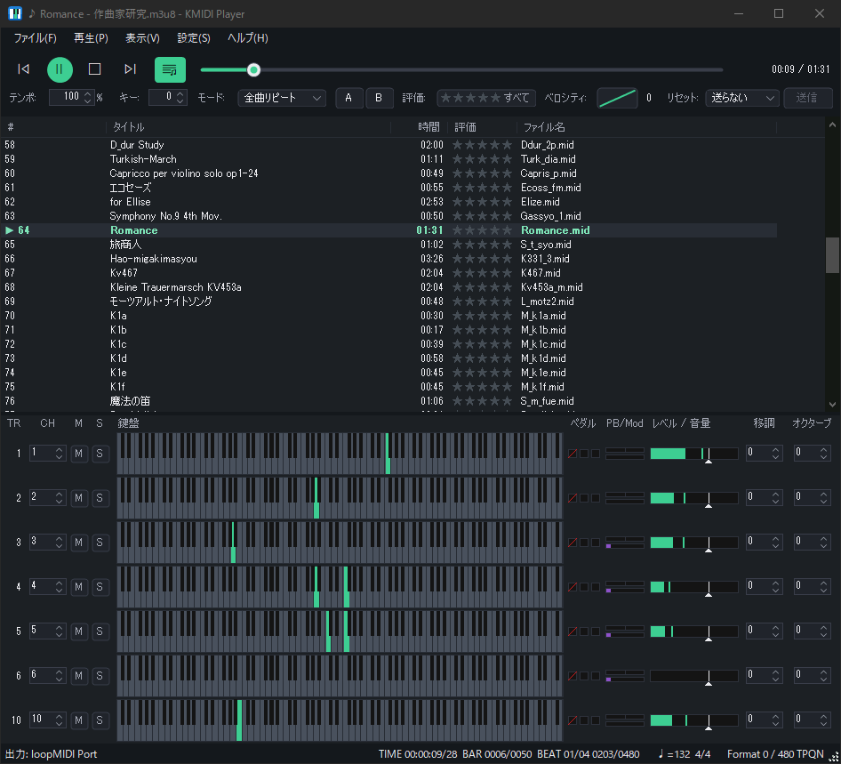
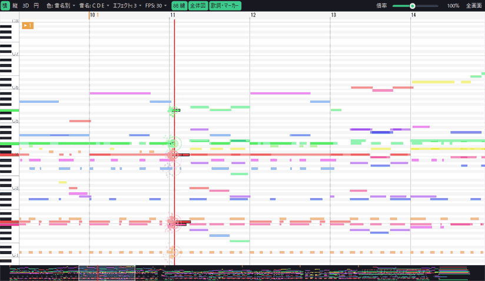
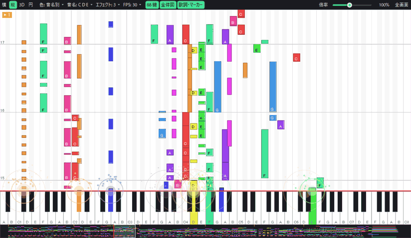
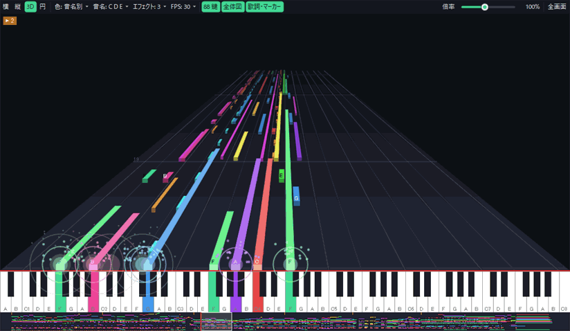
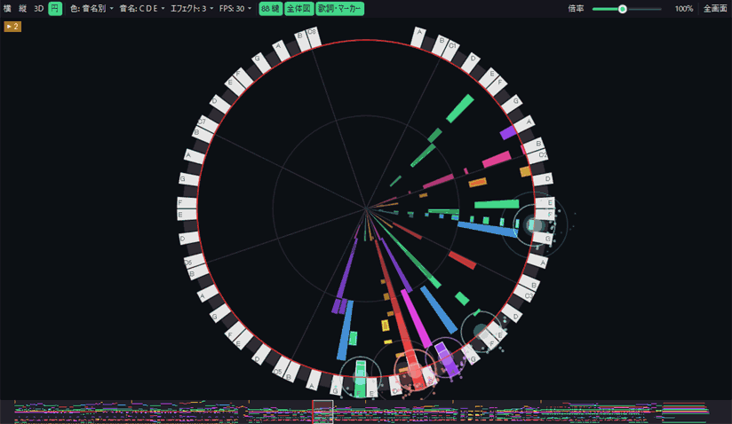

<p align="center">
  
</p>

<h1 align="center">KMIDI Player</h1>

<p align="center">
  <b>English</b> | <a href="README.ja.md">日本語</a>
</p>

<p align="center">
  A MIDI player for Windows. No installation needed: just double-click the exe.
</p>

---

KMIDI Player plays Standard MIDI Files (.mid) through a Windows MIDI output device, such as an external sound module, a software synth or the Microsoft GS Wavetable Synth.
Its window is built around the playlist, so you can keep a large collection of songs organised while you listen.
Keyboards and level meters for all 16 channels, and a piano roll, let you watch what is being played.

<p align="center">
  
</p>

### Piano roll

<table>
  <tr>
    <td align="center"><br>Side</td>
    <td align="center"><br>Falling</td>
  </tr>
  <tr>
    <td align="center"><br>3D</td>
    <td align="center"><br>Circle</td>
  </tr>
</table>

## Features

- **No installation:** It needs only .NET Framework 4.8, which comes with Windows 10 and 11. There is nothing else to install.
- **Playlist:** Add songs and folders by drag and drop, then reorder and play them. Playlists can be saved and loaded in M3U format. TMIDI Player playlists (.TO2) can also be loaded.
- **Ratings:** Rate each song from 1 to 5 stars, and play only the songs you choose, such as those with 3 stars or more.
- **Channel panel:** Shows the keyboard, pedals, pitch bend and level meter for all 16 channels. For each track you can change mute and solo, the output channel, transpose and octave, and volume.
- **Piano roll:** Four views (Side, Falling, 3D and Circle) show how the song flows. Notes light up with an effect when they reach the keyboard, and lyrics and markers are shown. Drawing is done on the GPU.
- **Playback controls:** Tempo (25–400%), key (±12 semitones), velocity curve, A-B loop, and five play modes (Play One, Repeat One, Play All, Repeat All and Shuffle).
- **Kind to your sound module:** A GM / GS / XG reset is sent automatically before playback. You can also stop specific CCs (such as pedals) from being sent to the module.
- **Themes and languages:** Switch between light and dark themes, and between Japanese and English.

## Requirements

| Item | Requirement |
|---|---|
| OS | Windows 10 (version 1903 or later) or Windows 11 |
| CPU | x64 (64-bit) |
| Runtime | .NET Framework 4.8 (included with the OS) |
| Sound output | A MIDI output device (the Microsoft GS Wavetable Synth built into Windows also works) |

## Download and start

1. Download the latest zip file from the [Releases](https://github.com/pritezza/KMIDI-Player/releases) page.
2. Extract the zip into any folder.
3. Double-click `KMidiPlayer.exe` to start it.

> **If "Windows protected your PC" appears**
> This happens because the app was downloaded from the internet and is not signed. Click "More info", then "Run anyway" to start it.

To uninstall, just delete the extracted folder. The registry is not used.

## Usage

The display language is Japanese the first time you start KMIDI Player. To switch to English, open **設定** (Settings) → **環境設定** (Preferences), and set **表示言語** (Language) to **English**.

1. In the **Settings** menu, choose the MIDI output device to play through.
2. Drag and drop MIDI files or folders onto the window to add them to the playlist.
3. Double-click a song to start playing.

The playlist is saved automatically when you quit, and restored the next time you start.

### Keyboard shortcuts

| Key | Action |
|---|---|
| Space | Play / pause |
| ← / → | Back 5 seconds / forward 5 seconds |
| Ctrl+← / Ctrl+→ | Previous song / next song |
| Enter | Play the selected song |
| Ctrl+O | Add files |
| Ctrl+S / Ctrl+Shift+S | Save the playlist / save it under a new name |
| Ctrl+C / Ctrl+X / Ctrl+V | Copy / cut / paste songs |
| Delete | Remove the selected songs from the list |
| 0–5 | Rate the selected song (0 means no rating) |
| F11 | Show the piano roll full screen |

## Where settings are saved

Settings (`KMidiPlayer.settings.xml`) and the playlist (`KMidiPlayer.playlist.m3u8`) are saved in the same folder as the exe. Copy the whole folder to take KMIDI Player, with its settings, to another PC.

If the exe's folder can't be written to (for example, under `Program Files`), they are saved in `%APPDATA%\KMIDI Player` instead.

## Supported files

| Type | Support |
|---|---|
| Standard MIDI File (.mid), Format 0 / 1 | Plays |
| Playlist (.m3u / .m3u8) | Loads and saves (ratings are saved too) |
| TMIDI Player playlist (.TO2) | Loads only |
| Format 2, RIFF MIDI (.rmi), RCP, MML, etc. | Not supported |

Text such as song titles and lyrics is read as Shift_JIS, as is common in Japanese MIDI files.

## Known limitations

- The Microsoft GS Wavetable Synth built into Windows has a fairly long delay before sound comes out. This is a limitation of Windows. Using an external sound module or a software synth (for example, through a virtual MIDI cable) avoids it.
- Files can't yet be passed to a KMIDI Player that is already running. Opening another file while it is running starts a second copy.

## Building from source

No external libraries or NuGet packages are used.

- Open `KMidiPlayer.sln` in **Visual Studio 2026** (with the ".NET desktop development" workload and the .NET Framework 4.8 Targeting Pack) and build it.
- Or, if you have the .NET SDK, build from the command line:

  ```
  dotnet build KMidiPlayer.sln -c Release
  ```

  This creates `src\KMidiPlayer\bin\x64\Release\net48\KMidiPlayer.exe`.

The detailed specification is in [docs/SPEC.md](docs/SPEC.md) (in Japanese).

## License

[MIT License](LICENSE)

## Author

PRITEZZA
